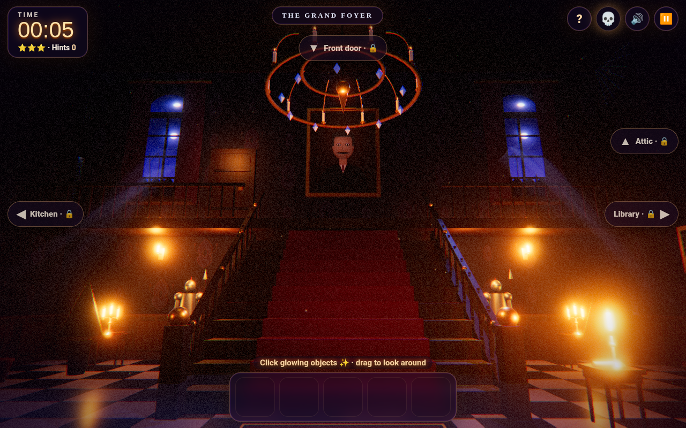

# 🏚️ Haunted Mansion Escape

A cinematic 3D Halloween escape room in the browser. Explore a candle-lit haunted mansion, solve its puzzles, survive a few scares and free the little ghost Wisp to escape into the moonlit garden.

**Play:** [online version (GitHub Pages)](https://frank-otto.github.io/haunted-mansion-escape/)

## How to play
- **Point & click:** click glowing objects, drag to look around, use the arrows to change rooms.
- **Walk mode (first person):** WASD / arrows to walk (Shift runs), mouse to look, E or click to use. On phones: a left-thumb joystick and drag to look.
- Pick up items, select them in the inventory and use them on things.
- Rooms: the grand foyer, the forbidden library, the witch's kitchen and the attic. Puzzles include a code lock, a candle order, a potion recipe and a music-box melody.
- Stuck? Ask Bones the talking skull for a hint (three levels per puzzle).

Extras: English by default with a **DE** toggle, a **kids mode** (friendly surprises instead of jump scares, extra help), autosave, a shareable **end card** (PNG, 1080×1350; the default name is "Player"), and **quality levels** (Low / Medium / High / Ultra).

## Tech
Three.js (WebGL): PBR materials with procedural textures and an environment map, flickering candle point lights with shadows, lightning that casts window shadows across the room, god rays, dust motes, layered fog, bloom and a cinematic color grade (vignette, film grain, chromatic split on scares). Bundled with esbuild into one classic script, so it runs straight from `file://`.

## Run locally
Open `index.html` directly (or double-click `start.command` on a Mac). To rebuild after editing `src/`:
```
npm install && npm run build
```

## Tests
`python3 test/test_game.py` (Playwright + Chrome, headless WebGL): a full playthrough in both control modes, every puzzle including wrong answers, hints, scares and kids mode, autosave, end card, quality levels, mobile controls and no console errors.

## Credits
All sounds are recorded CC0 samples (see `LICENSES/SOUNDS.md`). Three.js (MIT).


